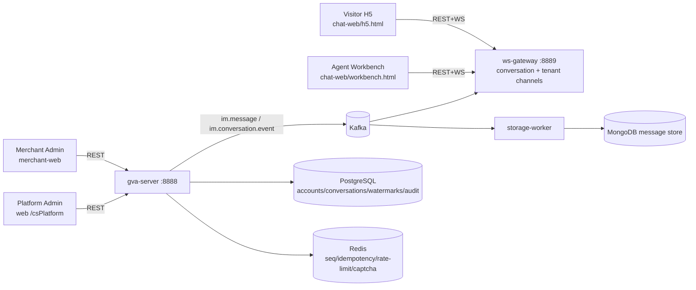

# gin-kefu Customer Support System

A **B2B multi-tenant live customer support system** built on top of [gin-vue-admin](https://github.com/flipped-aurora/gin-vue-admin). Once a merchant (tenant) is opened on the platform, it gets its own visitor channel, agent workbench and merchant admin. All four frontends are strictly isolated by `tenant_id`.

## Features

- **Four login scopes**: visitor H5 (password only), agent workbench / merchant admin / platform admin (password + image captcha + SMS MFA). Each scope has an independent token domain (`scope=member|agent|merchant|platform`); tokens are never interchangeable.
- **Full conversation lifecycle**: create → pending queue → claim (atomic, with hard limit) → transfer → close, with owner validation.
- **Realtime message pipeline**: REST send acknowledged by Kafka (`acks=all`) → storage-worker persists to MongoDB asynchronously → ws-gateway broadcasts per conversation. Monotonic in-conversation `seq` allocated atomically in Redis (cold start falls back to the PostgreSQL watermark / max stored Mongo seq).
- **Conversation lifecycle events**: `created/claimed/transferred/closed` published on a dedicated Kafka topic — the pending count on the workbench updates without refresh, and the H5 automatically switches from "pending" to "connected" once an agent claims.
- **Targeted unread notifications**: a visitor message notifies only the assigned agent (pending conversations notify the whole tenant to encourage claiming); the workbench splits unread badges per tab, with a sound chime and page-title counter.
- **Bot welcome message**: merchants configure `welcomeTemplate` on the channel; a bot message is auto-sent when a new conversation is created (idempotent — once per conversation).
- **Messaging capabilities**: text/image types (whitelist + scanned-attachment validation), idempotent resend via `clientMsgId` (24h), 7-day window for visitors vs. full history for agents, read cursors.
- **Merchant admin**: per-tenant agent/visitor account CRUD, channel settings (welcome text / domain whitelist), performance reports, audit log.
- **Platform admin**: tenant provisioning (first merchant admin created in the same transaction), protective deletion (refused while pending/active conversations exist; otherwise soft-deletes tenant and cascades accounts), global overview and audit.
- **LAN-friendly development**: frontend dev servers bind `0.0.0.0` for on-network testing.

## Architecture



- **Messages never hit PostgreSQL**: accounts, conversations, read watermarks and audit live in PostgreSQL; message bodies flow through Kafka and are persisted to MongoDB by the worker.
- **Two Kafka channels**: `im.message` (messages) and `im.conversation.event` (lifecycle events), consumed by ws-gateway in one group and dispatched onto per-conversation and per-tenant WS channels respectively.
- **No second login for the platform page**: when the GVA super admin is already logged in, opening the CS management page silently exchanges the framework token for a platform token (`POST /cs/platform/exchange`), falling back to in-page MFA on failure.

## Tech Stack

| Layer | Technology |
|---|---|
| Backend | Go 1.26 · Gin · GORM(PostgreSQL) · go-redis · kgo(Kafka) · MongoDB driver · gorilla/websocket |
| Frontend | Vue 3 · Vite · Element Plus (platform admin reuses the gin-vue-admin shell) |
| Middleware | Kafka (single-node KRaft, two topics) · Redis 7 · PostgreSQL 15 · MongoDB 7 |
| Deployment | Docker Compose (8 services) · in-image config.docker.yaml |

## Repository Layout

```
├── server/                 # Go backend (framework + CS domain)
│   ├── api/v1/cs/          # platform CS-domain APIs
│   ├── member/ merchant/   # visitor / merchant & agent APIs and routers
│   ├── service/cs/         # auth/conversation/message/tenant/channel/audit services
│   ├── model/cs/           # CS-domain models, request/response DTOs
│   ├── cmd/ws-gateway/     # WebSocket push gateway (separate process)
│   ├── cmd/storage-worker/ # Kafka → MongoDB persistence worker (separate process)
│   └── initialize/         # CS-domain migrations, seeding, router wiring
├── chat-web/               # Visitor H5 + agent workbench (dual-entry SPA)
├── merchant-web/           # Merchant admin
├── web/                    # Platform admin (gin-vue-admin frontend + csPlatform page)
├── deploy/ docker-compose.yml
├── scripts/                # e2e acceptance & load-test scripts
└── docs/cs/                # dev guide / deployment / test report
```

## Quick Start

### 1. Backend (Docker Compose)

```bash
docker compose up -d
```

Brings up 8 services: `pgsql` `redis` `mongo` `kafka` `kafka-init` (idempotent topic creation) `server`(:8888) `storage-worker` `ws-gateway`(:8889). First boot auto-creates CS tables and seed data (tenants demo/shopa/shopb with accounts).

### 2. Frontends (three dev servers)

```bash
cd chat-web && npm install && npm run dev        # :8090 visitor H5 + agent workbench
cd merchant-web && npm install && npm run dev    # :8091 merchant admin
cd web && npm install && npm run dev -- --port 8099 --strictPort   # platform admin
```

### 3. Entry Points

| Surface | URL | Notes |
|---|---|---|
| Visitor H5 | `http://127.0.0.1:8090/h5.html?t=<tenant code>` | `t` picks the merchant channel |
| Agent workbench | `http://127.0.0.1:8090/workbench.html?t=<tenant code>` | login refused if account/tenant mismatch |
| Merchant admin | `http://127.0.0.1:8091` | |
| Platform admin | `http://127.0.0.1:8099/#/layout/csPlatform/merchants` | reuses the framework super-admin session |

### 4. Demo Accounts (dev, password `123456` for all)

| Scope | Accounts | Tenant |
|---|---|---|
| Visitor | `member001` / `shopb_member` | demo / shopb |
| Agent | `agent001` (emp. no. 008) / `agent002` | demo |
| Merchant admin | `merchantadmin` / `shopbadmin` | demo / shopb |
| Platform | framework `admin` | the CS page can also mint its token from the framework session |

In development, captcha answers and SMS codes are returned as `devCaptcha`/`devCode` and auto-filled, so scripts can log in fully unattended.

## Acceptance & Load Tests

```bash
bash scripts/e2e-cs.sh                    # main-pipeline acceptance (67 checks: auth/conversation/messages/idempotency/events/multi-tenant isolation/delete protection)
node scripts/e2e-notify.mjs               # realtime event channel acceptance (10 checks)
node scripts/e2e-targeted-notify.mjs      # targeted unread-notification rules (6 checks)
node scripts/bench_cs.mjs                 # message-pipeline QPS benchmark (bottleneck analysis in docs/cs/test-report.md)
```

## Documentation

- [docs/cs/dev-guide.md](docs/cs/dev-guide.md) — API inventory, WS protocol (`subscribe`/`subscribeTenant`/`conv_event`/`tenant_message`), login sequence, event pipeline
- [docs/cs/deployment.md](docs/cs/deployment.md) — deployment & configuration (config.docker.yaml dependency switches, Kafka topics, image builds)
- [docs/cs/test-report.md](docs/cs/test-report.md) — acceptance and QPS benchmark report with bottleneck analysis
- [docs/cs/security-ratelimit.md](docs/cs/security-ratelimit.md) — security & rate-limit report (token domains / tenant isolation / file pipeline / limit table / anti-brute-force and known gaps)
- [docs/cs/sso-php.md](docs/cs/sso-php.md) — PHP integration guide for SSO passwordless entry (AES-256-GCM spec / samples / self-check)
- [docs/cs/production-deploy.md](docs/cs/production-deploy.md) — production deployment handbook (.env-centralized config, launch steps, security checklist, ops & rollback)
- [aiDoc/](aiDoc/README.md) — module rules, memory and relation maps oriented at AI-assisted collaboration

## Development Conventions

- CS-domain routers are derived from PublicGroup with the domain's own middleware only (the framework PrivateGroup's JWTAuth+Casbin would double-auth and block them); tenant isolation is enforced server-side from token claims — client-supplied tenant context is never trusted.
- Side channels (events, notifications) must never block the main business flow; failures are log-only.
- All frontend dev servers bind `0.0.0.0` for LAN collaboration.

## License

This project is derived from [gin-vue-admin](https://github.com/flipped-aurora/gin-vue-admin) (Apache-2.0). See [LICENSE](LICENSE) and [aiDoc/relations/licensing-and-branding.md](aiDoc/relations/licensing-and-branding.md) for licensing and branding notes.
