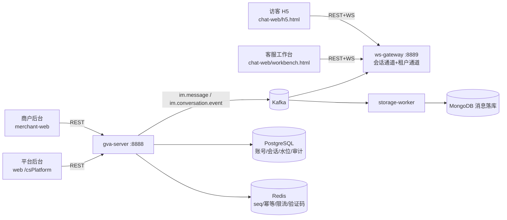

# gin-kefu 客服系统

**B2B 多商户在线客服系统**。平台开通商户（租户）后，每个商户拥有独立的访客接入渠道、客服工作台与商户管理后台，四端数据按 `tenant_id` 严格隔离。

## 功能特性

- **四端登录体系**：访客 H5（仅账密）、客服工作台 / 商户后台 / 平台管理（账密 + 图形验证码 + 短信 MFA），各端独立令牌域（`scope=member|agent|merchant|platform`），跨端令牌互不通用
- **会话全生命周期**：新建 → 待接入排队 → 抢单接入 → 转接 → 关闭；并发抢单原子锁定、当值者校验、硬上限限制
- **实时消息链路**：REST 发送（Kafka `acks=all` 确认）→ storage-worker 异部落库 MongoDB → ws-gateway 按会话广播；会话内 seq 单调（Redis 原子分配，冷启动以 PG 水位/Mongo 最大值兜底）
- **会话生命周期事件**：`created/claimed/transferred/closed` 走独立 Kafka topic 推送，客服端待接入数免刷新实时变化，用户端接入成功自动"待接入 → 已接入"
- **定向未读提醒**：访客消息只提醒当值客服（待接入会话提醒全租户鼓励认领）；工作台按页签分流未读角标 + 提示音 + 浏览器标题计数
- **机器人欢迎语**：商户在渠道配置 `welcomeTemplate`，新会话创建后由 bot 角色自动发送（同一会话幂等只发一次）
- **消息能力**：文本 / 图片消息（类型白名单 + 附件扫描校验）、幂等重发（clientMsgId 24h）、用户侧 7 天窗口 vs 客服侧全量历史、已读水位
- **商户管理**：本租户客服/访客账号 CRUD、渠道配置（欢迎语/域名白名单）、接待报表、操作审计
- **平台管理**：租户开通（同事务创建首个商户管理员）、保护性删除（有进行中会话即拒绝级联软删账号）、全局概览与审计
- **内网穿透支持**：前端 dev server 绑定 `0.0.0.0`，可通过局域网 IP 直接访问联调

## 系统架构



- **消息不存 PG**：会话/账号/已读水位/审计在 PostgreSQL，消息本体经 Kafka 由 worker 落 MongoDB
- **两条 Kafka 通道**：`im.message`（消息）与 `im.conversation.event`（会话生命周期事件），ws-gateway 同组消费后分别投递会话级与租户级 WS 通道
- **平台后台免二次登录**：GVA 超管已登录时，进入客服管理页自动以框架登录态静默换取平台令牌（`POST /cs/platform/exchange`），失败回退页内 MFA

## 技术栈

| 层 | 技术 |
|---|---|
| 后端 | Go 1.26 · Gin · GORM(PostgreSQL) · go-redis · kgo(Kafka) · MongoDB Driver · gorilla/websocket |
| 前端 | Vue 3 · Vite · Element Plus（web 平台后台沿用  框架） |
| 中间件 | Kafka（KRaft 单节点，双 topic）· Redis 7 · PostgreSQL 15 · MongoDB 7 |
| 部署 | Docker Compose（8 服务）· 镜像内 config.docker.yaml |

## 目录结构

```
├── server/                 # Go 后端（框架 + 客服业务域）
│   ├── api/v1/cs/          # 平台客服域接口
│   ├── member/ merchant/   # 访客端 / 商户端 / 工作台接口与路由
│   ├── service/cs/         # 认证/会话/消息/租户/渠道/审计领域服务
│   ├── model/cs/           # 客服域模型与请求响应
│   ├── cmd/ws-gateway/     # WebSocket 推送网关（独立进程）
│   ├── cmd/storage-worker/ # Kafka → MongoDB 落库 worker（独立进程）
│   └── initialize/         # 客服域建表/种子/路由装配
├── chat-web/               # 访客 H5 + 客服工作台（双入口 SPA）
├── merchant-web/           # 商户管理后台
├── web/                    # 平台管理后台前端 + csPlatform 页）
├── deploy/ docker-compose.yml
├── scripts/                # e2e 验收与压测脚本
└── docs/cs/                # 开发手册 / 部署文档 / 测试报告
```

## 快速开始

### 1. 启动后端（Docker Compose）

```bash
docker compose up -d
```

拉起 8 个服务：`pgsql` `redis` `mongo` `kafka` `kafka-init`（幂等创建双 topic）`server`(:8888) `storage-worker` `ws-gateway`(:8889)。首次启动自动完成客服域建表与种子数据（租户 demo/shopa/shopb 及账号）。

### 2. 启动前端（三个 dev server）

```bash
cd chat-web && npm install && npm run dev        # :8090 访客 H5 + 客服工作台
cd merchant-web && npm install && npm run dev    # :8091 商户后台
cd web && npm install && npm run dev -- --port 8099 --strictPort   # 平台后台
```

### 3. 访问入口

| 端 | 地址 | 说明 |
|---|---|---|
| 访客 H5 | `http://127.0.0.1:8090/h5.html?t=<租户code>` | `t` 决定进入哪个商户渠道 |
| 客服工作台 | `http://127.0.0.1:8090/workbench.html?t=<租户code>` | 账号与渠道不匹配拒绝登录 |
| 商户后台 | `http://127.0.0.1:8091` | |
| 平台后台 | `http://127.0.0.1:8099/#/layout/csPlatform/merchants` | 框架超管登录后免二次 MFA |

### 4. 演示账号（开发环境，密码统一 `123456`）

| 端 | 账号 | 归属 |
|---|---|---|
| 访客 | `member001` / `shopb_member` | 租户 demo / shopb |
| 客服 | `agent001`(工号008) / `agent002` | 租户 demo |
| 商户管理员 | `merchantadmin` / `shopbadmin` | 租户 demo / shopb |
| 平台 | 框架 `admin` | csPlatform 页内亦可直用框架登录态换取令牌 |

开发环境 MFA 的图形码答案与短信验证码由接口 `devCaptcha`/`devCode` 字段直接返回并自动回填，脚本可全自动登录。

## 验收与压测

```bash
bash scripts/e2e-cs.sh                    # 主链路验收（67 项：认证/会话/消息/幂等/事件/多租户隔离/删除保护）
node scripts/e2e-notify.mjs               # 实时事件通道验收（10 项：租户通道/生命周期事件/h5 自动转已接入）
node scripts/e2e-targeted-notify.mjs      # 未读提醒定向规则验收（6 项）
node scripts/bench_cs.mjs                 # 消息链路 QPS 压测（瓶颈定位见 docs/cs/test-report.md）
```

## 文档

- [docs/cs/dev-guide.md](docs/cs/dev-guide.md) —— 接口清单、WS 协议（subscribe/subscribeTenant/conv_event/tenant_message）、登录序列、事件链路
- [docs/cs/deployment.md](docs/cs/deployment.md) —— 部署与配置说明（config.docker.yaml 依赖开关、Kafka topic、镜像构建）
- [docs/cs/test-report.md](docs/cs/test-report.md) —— 验收与 QPS 压测报告、瓶颈分析
- [aiDoc/](aiDoc/README.md) —— 面向 AI 协作的模块规则、记忆与关系图谱

## 开发约定

- 业务域路由从 PublicGroup 派生并只挂客服域自有中间件（框架 PrivateGroup 的 JWTAuth+Casbin 会双重鉴权拦截）；租户隔离在服务端以 claims 强制，不信任客户端传参
- 事件/提醒等旁路链路失败一律不阻断业务主流程（仅记日志）
- 前端三端 dev server 必须绑定 `0.0.0.0` 以支持局域网联调


